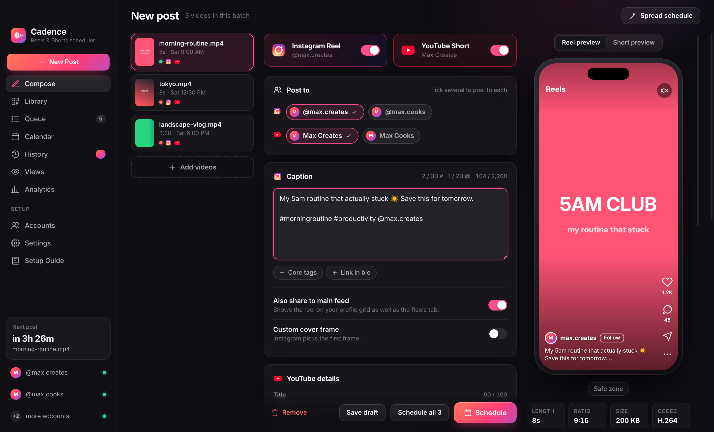
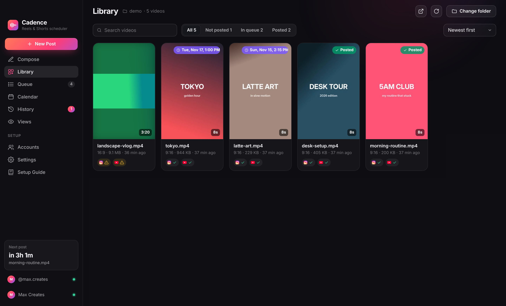
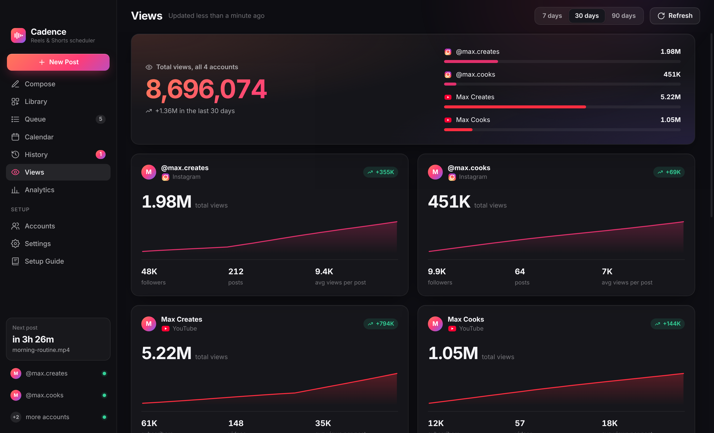
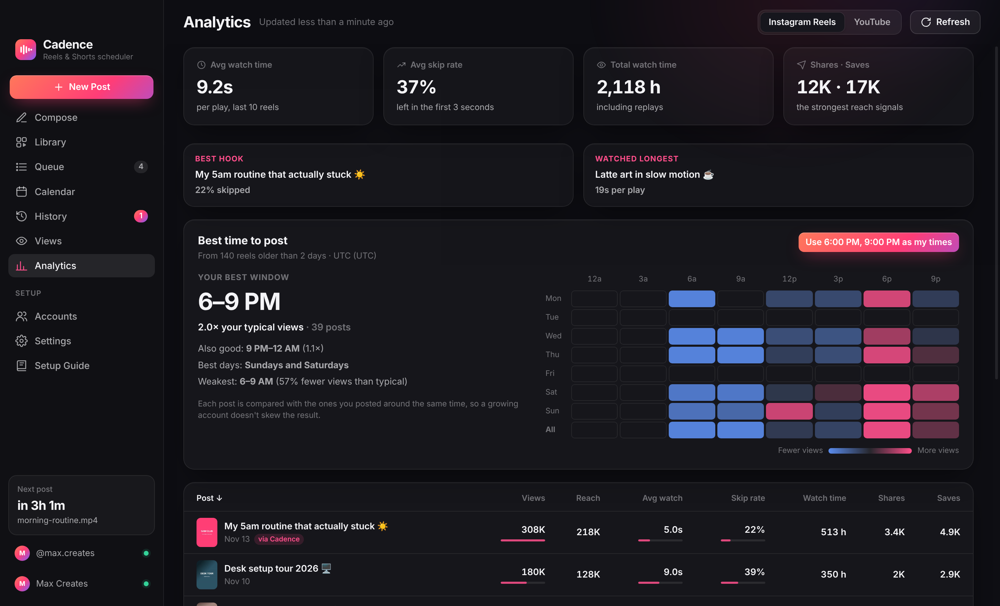
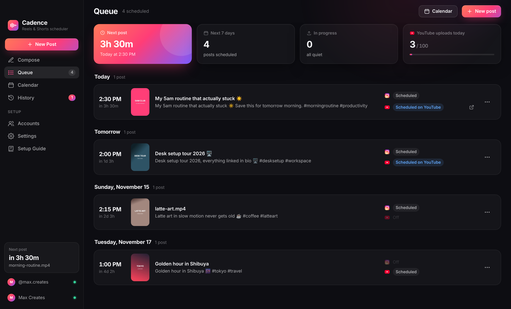
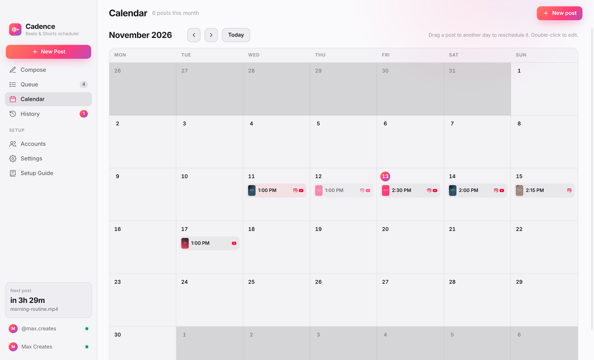

# Cadence

Schedule Instagram Reels and YouTube Shorts from your Mac. Pick MP4s from your computer, write the caption once, choose a time, and Cadence posts them for you.



## What it does

- **Drag in videos** (MP4 or MOV). Cadence checks length, aspect ratio, size, codec and frame rate against what Instagram and YouTube accept before you schedule anything.
- **As many accounts as you like.** Connect several Instagram accounts and YouTube channels, and pick which ones each post goes to.
- **One caption, two platforms.** The YouTube title fills itself from your caption's first line, with live character, hashtag and mention counters.
- **Live phone preview** of the Reel and the Short, with a safe-zone overlay and a cover-frame picker.
- **Custom YouTube thumbnails.** Pick or drop a PNG/JPEG; Cadence fits it to YouTube's 2 MB limit and sets it after upload.
- **Batch scheduling.** Drop several videos and spread them across your favourite posting times in one click.
- **Library tab.** Point Cadence at your exports folder and see every video with a thumbnail, hover-to-play, and a Reel/Short readiness check. Badges show what's already posted or queued; select several and create posts in one go. Zoom from 2 to 12 videos per row.
- **Views tab.** Total views per Instagram account and YouTube channel, combined total, growth over 7/30/90 days, and your top posts.
- **Analytics tab.** Average watch time, skip rate, shares and saves per Reel; average % viewed, retention graph (with **retention replay**: your Short plays next to the graph and the biggest drop-offs are marked), traffic sources and subscribers gained per YouTube video. A **best time to post** heatmap shows which hours and weekdays work for you, and sets your default posting times in one click, and **best video length** shows which lengths get the most views and the most watching.
- **Queue, calendar and history.** Drag posts between days, retry failures, and see an activity log for every post.
- **Posts straight to the official APIs** (Instagram Graph API and YouTube Data API). No third-party service, nothing stored online. Your keys stay in the macOS Keychain.

| Library | Views |
| --- | --- |
|  |  |
| **Analytics** | |
|  | |
| **Queue** | **Calendar** |
|  |  |

## How scheduling works

- **YouTube:** public Shorts are uploaded right away and scheduled on YouTube itself, so they go live even if your Mac is off.
- **Instagram:** Instagram's API has no scheduling, so Cadence uploads about 10 minutes early and publishes at the exact time. Your Mac must be awake with Cadence running (it lives in the menu bar and keeps the Mac from sleeping while posts are queued). If a post is missed, it is published as soon as the Mac wakes, or Cadence asks first, depending on your settings.

## Get it

1. Download the latest `Cadence-x.y.z-arm64.dmg` (Apple Silicon) or `-x64.dmg` (Intel) from [Releases](../../releases), or from the **Cadence-dmg** artifact of the latest [Actions](../../actions) run.
2. Drag Cadence to Applications, then follow **[the setup guide](docs/SETUP.md)** (about 20 minutes, once). It is also built into the app under **Setup Guide**.

## Development

```bash
npm install
npm run dev        # run the app with hot reload
npm test           # unit + integration tests (needs ffmpeg for video fixtures)
npm run typecheck
npm run dist       # build the .dmg (on a Mac)
```

Built with Electron, React and TypeScript, with no runtime dependencies in the main process.
